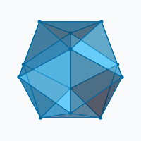

# AI Automation Engineer
### LLM agents · Workflow automation · Evals · Ad ops · Medical AI

---

## What I do

I build automations where an LLM does real work inside a business process — pulling data from APIs, analysing it, and handing a person a decision instead of a spreadsheet. I came from performance marketing, so I start from the process and the metric, not from the model: what has to happen, how we will know it worked, and what it costs per run. My main domain is paid ads across Yandex Direct, Meta, Google Ads and YouTube Ads; the second is medicine, where I study how agents should be trained and evaluated before they get anywhere near a clinical decision.

The thread through all of it is checking whether a model actually does what it seems to do. I ran 15 controlled experiments on Claude and Qwen models — hundreds of sub-agent instances, pre-registered comparisons, blind LLM-as-judge coding, LoRA fine-tuning — and published the data and code. That habit carries over to every agent I build: evals first, demos second.

---

## 🧪 Featured: LLM introspection experiments

**[llm-introspection-experiments →](https://github.com/Kristina89-oss/llm-introspection-experiments)**

Can a language model report on its own internal states — and does it have a past of its own? Nine studies and a pre-registered replication series, run with Claude Code as the orchestration layer.

| | |
|---|---|
| **Scale** | 785 Claude instances (Opus 5 / 5.5, Haiku 4.5) + 38 blind coders; Qwen2.5-1.5B/3B fine-tuned on a 4 GB laptop GPU |
| **Method** | Isolated sub-agents per condition, pre-registration, two blind LLM coders (κ 0.71–1.0), Wilson/Newcombe CIs, Holm correction |
| **Finding** | Introspection exists only *within a single computation*; between turns the model reads its own past like an outsider — **the past is public** |
| **Honesty** | One headline effect did not survive replication (it was word order in the prompt) — reported as such |

📄 [Article](https://github.com/Kristina89-oss/llm-introspection-experiments/blob/main/article.md) · 🧪 [All studies](https://github.com/Kristina89-oss/llm-introspection-experiments/blob/main/experiments.md) · 📚 [191 sources](https://github.com/Kristina89-oss/llm-introspection-experiments/blob/main/sources.md) · 🌐 [Notion companion](https://experienced-hygienic-9aa.notion.site/Consciousness-and-AI-Experiments-Sources-and-Notes-3f2e2190382d81709bf3ef6fe4d0ade4) · 💾 [Data & code (Zenodo)](https://doi.org/10.5281/zenodo.23365351)

---

## ⚙️ Ad automation

One pipeline across four ad platforms — **Yandex Direct · Meta Ads · Google Ads · YouTube Ads** — built around three jobs:

| Job | What it does | Stack |
|---|---|---|
| **Statistics analysis** | Pulls campaign stats from every platform's API into one table, and a low-cost LLM writes the daily read-out: what moved, why, what to change | n8n · ad platform APIs · Google Sheets · Gemini |
| **Competitor scoring** | Collects competitors' ads and scores them, so the next test starts from what is working in the market | n8n · LLM scoring |
| **Creative replacement** | Spots creatives that are burning out by their metrics and swaps in or drafts the replacements | n8n · ad platform APIs · LLM |
| **Telegram budget bot** | Watches ad spend and sends budget alerts and summaries to Telegram | n8n · Telegram Bot API |

## 🩺 Medical AI

How should an agent be trained and checked before it advises on treatment? I work on prostate-cancer data from [Project Data Sphere](https://www.projectdatasphere.org/): longitudinal PSA series from the control arms of 9 mCRPC trials (~4,000 patients), harmonised into one dataset, a mechanistic PSA model and patient "twins" used as a test bench for agents. The rule I hold to: a twin has to beat a trivial baseline before agents are compared with doctors on it — in the first run it did not, so that comparison was not made. Aggregate research only; nothing here is medical advice.

## 🔧 Other automation
| Project | What it does | Stack |
|---|---|---|
| **Local LLM parsing** | Turns unstructured text into structured fields with a local model, so data never leaves the machine | n8n · Ollama |
| **Research orchestration** | Runs hundreds of isolated model instances per experiment, blind-codes answers with LLM judges, recomputes every statistic from raw counts | Claude Code · Python · PyTorch · PEFT/LoRA |

### 🚧 Building now

- **Ad-Ops agent** — a production agent on Yandex Direct: tool use, guardrails, logging, cost per run
- **RAG + eval harness** — retrieval over marketing docs with hybrid search, reranking and an automatic eval set
- **GTM engine** — lead qualification bot (BANT), CRM sync, ICP scoring
- **MCP server for Yandex Direct** — so any agent can read and manage campaigns, with trajectory evals

---

## 🧭 Core skills

| Area | Skills |
|---|---|
| Agents & LLM apps | Tool use / function calling · ReAct · Model routing · Prompt design · MCP |
| Retrieval | RAG · Chunking · Hybrid search · Rerankers · GraphRAG |
| Evaluation | LLM-as-judge · Blind double coding · Pre-registration · Confidence intervals · Tracing |
| Automation | n8n · REST APIs · Webhooks · Google Sheets · Telegram bots |
| Models | Claude · Gemini · Ollama · Qwen fine-tuning (LoRA / QLoRA) |
| Domain | Performance marketing · Ad ops · GTM · Clinical trial data |

---

## 🛠️ Tools

---

🗂️ Side projects — open-source research I do for fun

 

**🔎 [Wallet check](https://github.com/Kristina89-oss/tracing-dashboard)** — a local single-page tool for checking a crypto wallet the way an investigator would by hand: FATF-style red-flag scoring, sanctions / USDT-freeze / phishing-list screening, mixer and cross-chain bridge tracing, and OSINT from one address or tx hash. Built on my own [bridge tracer](https://github.com/Kristina89-oss/bridgetrail), [mixer heuristics](https://github.com/Kristina89-oss/mixer-tracing-tools) and API clients for [Etherscan](https://github.com/Kristina89-oss/etherscan-client) and [Chainabuse](https://github.com/Kristina89-oss/chainabuse-client).

**On-chain investigations**

| Case | What I found |
|---|---|
| **[TRON investigation writeup](https://github.com/Kristina89-oss/tron-investigation-writeup)** | How a $72M Tether freeze unravelled into a 761-address USDT laundering network — written step by step, mistakes included |
| **[TRON/USDT laundering network](https://github.com/Kristina89-oss/tron-laundering-investigation)** | A laundering trail public reporting missed, plus a hidden bridge to a second network; FATF-scored addresses |
| **[TRON phishing kit → USDT resale](https://github.com/Kristina89-oss/TRON-Phishing-Kit-and-USDT-Laundering-Network-)** | A fake refund site feeding a storefront that resells stolen USDT on Telegram |
| **["TGR Exchange" cash-out scam](https://github.com/Kristina89-oss/TGR-scam-exchange-case)** | From one victim report through wallet fund flows, the ad campaign and hosting records to the operators |

**OSINT databases**

| Database | Covers |
|---|---|
| **[Arms trafficking: Türkiye → Europe](https://github.com/Kristina89-oss/Arms-trafficking-Turkiye-Europe)** | Turkish blank-firing pistols smuggled into Europe and converted to live weapons |
| **[Crime Networks Database](https://github.com/Kristina89-oss/Crime-networks-Database)** | Scandinavian and Turkish-origin organised crime groups, source-tagged |
| **[China–DRC Database](https://github.com/Kristina89-oss/China-DRC-Database)** | China's mining, cobalt, corruption and security footprint in the DRC |

